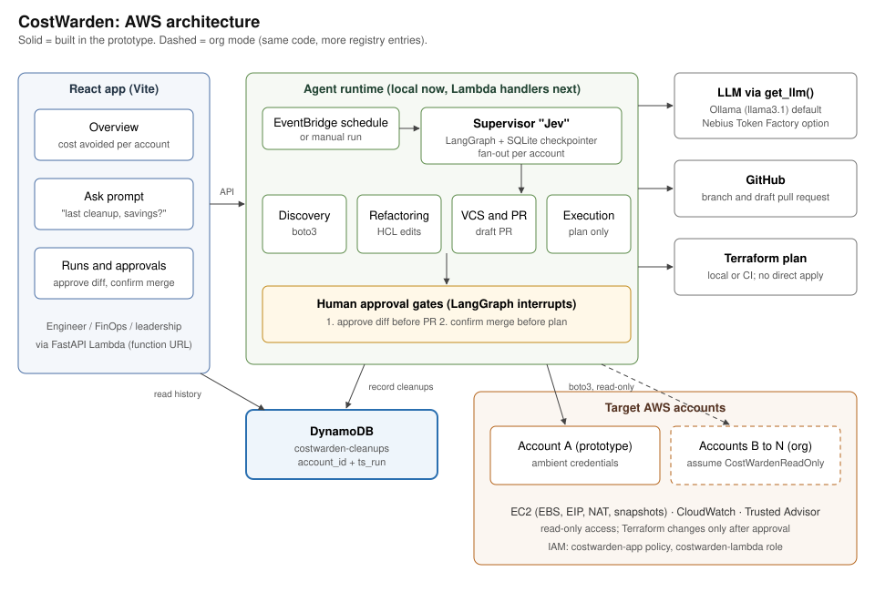

# CostWarden

Proactive, continuous guarding against cloud waste.

CostWarden is a multi-agent system built with LangGraph and LangChain. A supervisor agent routes work between specialized agents, validates state transitions and enforces guardrails, such as mandatory human approval, before any infrastructure change.

> **Status:** the agents, supervisor graph, history store, dashboard, Ask prompt, Lambda handlers and Terraform are built and covered by 93 tests (moto and a fake LLM; no real AWS, GitHub or Ollama calls). Not yet verified: a live run against Ollama, a real GitHub PR, and a real `terraform apply` of the Lambda stack. See the [spec](docs/superpowers/specs/2026-10-24-costwarden-multi-account-design.md) and the [plan](docs/superpowers/plans/2026-10-24-costwarden-multi-account.md).

## One-liner

My agent helps a cloud or FinOps engineer remove idle AWS waste in a Streamlit app, replacing the manual hunt through Trusted Advisor and Terraform that takes hours each month. It discovers waste, edits the Terraform and opens a PR on its own using 5 tools, hands off to a human for approval before anything is applied, and I'll know it works when a draft PR with a savings estimate is ready in under 5 minutes on 4 of 5 seeded cases.

## Architecture



| Component | Role |
|---|---|
| Streamlit frontend | Dashboard (cost avoided per account), Ask prompt (questions about past cleanups) and the run and approval screens. |
| Supervisor "Zeve" | LangGraph state machine. Discovers all accounts in parallel, then works through accounts one at a time and pauses at human approval gates. Checkpoints go to DynamoDB so a pause survives across Lambda calls. |
| Discovery, Refactoring, VCS and PR, Execution agents | The four worker agents (roles below). Each runs in-process locally or as its own Lambda (`costwarden-discover`, `-refactor`, `-open_pr`, `-execute`), with the supervisor Lambda `costwarden-supervisor` in front. |
| DynamoDB `costwarden-cleanups` | History of every cleanup: account, resources, monthly savings, PR URL and status. Feeds the dashboard and the prompt. |
| LLM via `get_llm()` | Ollama (`llama3.1`) by default; Nebius Token Factory as a second provider. |
| Target AWS accounts | Prototype: one account using ambient credentials. Org mode: more entries in `config/accounts.yaml`, each assumed through a read-only `CostWardenReadOnly` role. |

### Multi-account design

Every agent receives an `Account` (id, role ARN, region, Terraform path, repo) from a registry. `get_session(account)` assumes the account's role through STS, or uses the default session when no role is set. Findings carry `account_id` through the whole graph, so scaling from one account to an organization means adding registry entries, not changing agent code.

### Human-in-the-loop

Reads are autonomous. Every write sits behind a LangGraph interrupt:

1. Approve the diff before the branch and draft PR are created.
2. Confirm the merge before the Terraform plan runs.

The agents never apply changes directly and never delete resources through the AWS API.

### Dashboard and prompt

- **Dashboard:** per-account cost avoided (monthly run-rate and cumulative), cleanups by status, open PRs, findings by resource type and a savings trend. Cost avoided counts merged cleanups only.
- **Ask prompt:** questions like "what was the last cleanup and how much did it avoid?" The model chooses one of a few fixed query tools over the history table, and the numbers in the answer come from the table, not from the model.

## Agent roles and responsibilities

### Supervisor agent ("Zeve")

- Manages overall state transitions and routing.
- Evaluates sub-agent outputs against acceptance criteria.
- Pauses graph execution for human-in-the-loop approval before applying code changes.

### Discovery agent (Trusted Advisor, Cost Explorer, CloudWatch)

- Queries AWS through boto3 (the prototype's checks use EC2 and CloudWatch; Trusted Advisor and Cost Optimization Hub are planned extensions).
- Filters actionable idle or unattached resources: unattached EBS volumes, idle NAT gateways, unassociated Elastic IPs and aged snapshots.
- Produces a normalized inventory of resource IDs, ARNs and target Terraform files.

### Refactoring agent (Terraform and OpenTofu)

- Maps idle resources to HCL configuration files in the repository.
- Makes declarative edits, such as setting `count = 0`, located with python-hcl2.
- Runs `terraform fmt` and `terraform validate` when the binary is available.

### VCS and PR agent (GitHub)

- Creates a branch named `costwarden/cleanup-YYYY-MM-DD-<account>`.
- Commits the updated HCL and opens a draft pull request with estimated monthly savings, targeted resources and risk severity.

### Execution agent (CI/CD)

- Runs only after the PR is merged and a human confirms.
- Runs `terraform plan` and posts the summary back to the supervisor state. Applying remains with your CI/CD pipeline.

## Quick start (local, no AWS needed)

```bash
python3.13 -m venv .venv
.venv/bin/pip install -e ".[ui,dev]"
.venv/bin/python -m pytest
LLM_PROVIDER=fake STORE_BACKEND=memory .venv/bin/streamlit run costwarden/ui/app.py
```

In the app, click **Load demo history** in the sidebar, then try the Dashboard, the Ask tab, and **Start cleanup run** (it works on the bundled dummy Cost Explorer data in `data/dummy_cost_explorer.json` and the sample Terraform in `sample_terraform/`).

For real Ollama, set `LLM_PROVIDER=ollama` in `.env` (see `.env.example`); the server must be reachable from your network.

## Deploy the AWS resources

[infra/terraform](infra/terraform) creates everything: the history and checkpoint DynamoDB tables, IAM, an S3 bucket for the package, the four agent Lambdas, the supervisor Lambda and, optionally, seeded demo waste.

```bash
scripts/build_lambda.sh
cd infra/terraform
terraform init
terraform apply -var nebius_api_key=... -var github_token=... -var github_repo=owner/costwarden-sandbox
```

- `build_lambda.sh` writes `build/lambda.zip` (Linux x86_64, Python 3.12). Run it before `terraform apply`.
- Leave `github_repo` empty to use a fake GitHub client. The Lambdas then bundle the sample Terraform and open no real PRs.
- The Lambdas are not in a VPC, so they cannot reach the private Ollama server. They default to `lambda_llm_provider=nebius`; use `fake` for an offline demo.
- `github_token` and `nebius_api_key` are stored as Lambda environment variables. Use a narrowly scoped token on a sandbox repository.
- Add `-var create_demo_waste=true` to create an unattached EBS volume and an unassociated Elastic IP (about $3.70 per month).

Seed the dashboard, then point the Streamlit app at the deployed supervisor:

```bash
.venv/bin/python scripts/seed_demo_data.py --region us-east-1
AGENT_RUNTIME=lambda STORE_BACKEND=dynamo .venv/bin/streamlit run costwarden/ui/app.py
```

The machine running Streamlit needs AWS credentials with the `costwarden-app` policy (output `app_policy_arn`). Destroy everything with `terraform destroy`.

## Configuration

| Variable | Default | Purpose |
|---|---|---|
| `LLM_PROVIDER` | `ollama` | `ollama`, `nebius` or `fake` (tests and offline demo). |
| `OLLAMA_BASE_URL` | `http://10.135.128.9:11434` | Ollama endpoint. |
| `LLM_MODEL` | `llama3.1` | Model name. |
| `DYNAMODB_TABLE` | `costwarden-cleanups` | History table. |
| `STORE_BACKEND` | `dynamo` | `dynamo` or `memory`. |
| `CHECKPOINT_BACKEND` | `memory` | `memory` locally, `dynamo` on Lambda. |
| `AGENT_RUNTIME` | `local` | `local` runs agents in-process; `lambda` calls the deployed functions. |
| `TF_SOURCE` | `local` | `local` reads `tf_path` from disk; `github` reads it from the sandbox repo. |
| `GITHUB_TOKEN`, `GITHUB_REPO` | empty | Real draft PRs on a sandbox repo; empty uses a fake client. |

## Repository layout

```
costwarden/            application code (agents, supervisor graph, store, UI, Lambda handlers)
config/accounts.yaml   account registry (two demo accounts)
data/                  dummy Cost Explorer export
sample_terraform/      Terraform the Refactoring agent edits
infra/terraform/       tables, IAM, Lambdas, demo waste
scripts/               build_lambda.sh, seed_demo_data.py
tests/                 pytest suite
docs/                  architecture diagram, specs, plans
```

## Limits of the prototype

- The agents never apply Terraform. The Execution agent runs `terraform plan` only when the binary is present (not in Lambda); applying stays with your CI/CD pipeline.
- Accounts are processed one at a time after discovery, so approvals are sequential per account.
- A resize or release changes only the Terraform on a branch. Cost avoided is counted when a human confirms the merge, not from the actual AWS bill.
- Terraform edits are text patches validated by parsing with python-hcl2; `terraform validate` is not run.
- Checkpoints are stored as one compressed item per run and unpickled on read, so the checkpoint table must only be writable by the CostWarden role.
- The Ollama server is reachable only from the right network, so tests and the offline demo use a fake LLM.
